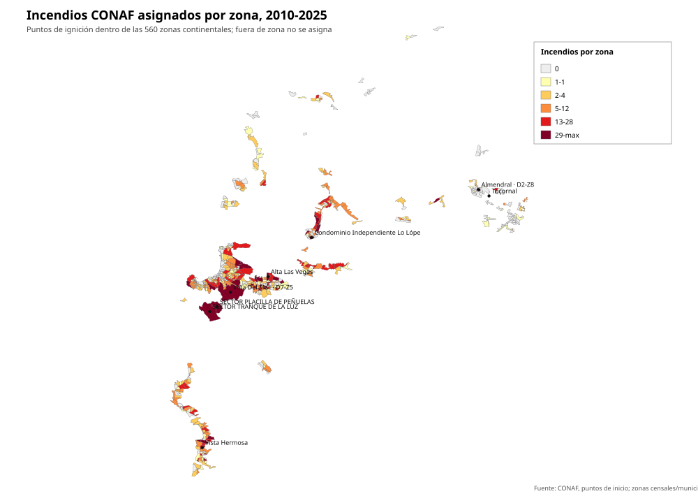
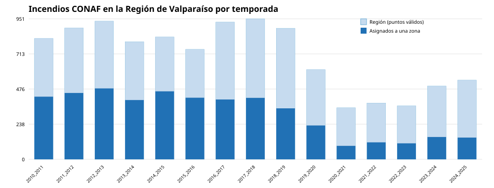

# EDA reproducible: incendios CONAF y zonas de Valparaíso

Generado: `2026-11-14T02:07:38.847110+00:00`.

## Alcance

El objetivo es predecir **ocurrencia de al menos un punto de ignición CONAF** en una zona y temporada, no un índice de riesgo operativo. Las etiquetas se construyen por intersección espacial estricta entre puntos CONAF y polígonos de zona.

## Cobertura espacial

- Zonas usadas: **560** (se excluyen Isla de Pascua y Juan Fernández).
- Área suma de zonas: **613.7 km²**, equivalente a **3.74%** del área regional de referencia (16396 km²).
- Puntos CONAF válidos en la Región de Valparaíso continental: **10508**.
- Puntos asignados a alguna zona: **4638** (0.441).
- Puntos fuera de toda zona: **5870**.
- Distancia de los no asignados a la zona más cercana: mediana **1.82 km**, p90 **11.44 km**.

Esta cobertura es la limitación central: el modelo aprende sobre una fracción urbana/periurbana de la región, no sobre todo el territorio forestal.





## Incendios por temporada

| Temporada | Registros | Región 5 | Puntos válidos | Asignados | No asignados | Tasa asignación |
|---|---|---|---|---|---|---|
| 2010_2011 | 4872 | 819 | 818 | 424 | 394 | 0.518 |
| 2011_2012 | 5439 | 890 | 889 | 449 | 440 | 0.505 |
| 2012_2013 | 5563 | 936 | 935 | 480 | 455 | 0.513 |
| 2013_2014 | 6297 | 804 | 796 | 401 | 395 | 0.504 |
| 2014_2015 | 8008 | 829 | 828 | 460 | 368 | 0.556 |
| 2015_2016 | 6765 | 744 | 744 | 417 | 327 | 0.560 |
| 2016_2017 | 5234 | 929 | 929 | 405 | 524 | 0.436 |
| 2017_2018 | 6048 | 953 | 951 | 416 | 535 | 0.437 |
| 2018_2019 | 7201 | 887 | 887 | 345 | 542 | 0.389 |
| 2019_2020 | 8106 | 608 | 607 | 229 | 378 | 0.377 |
| 2020_2021 | 7030 | 349 | 349 | 91 | 258 | 0.261 |
| 2021_2022 | 6884 | 381 | 381 | 115 | 266 | 0.302 |
| 2022_2023 | 6944 | 362 | 362 | 108 | 254 | 0.298 |
| 2023_2024 | 4972 | 498 | 496 | 151 | 345 | 0.304 |
| 2024_2025 | 6262 | 536 | 536 | 147 | 389 | 0.274 |

## Balance de etiquetas por temporada objetivo

| Temporada | Filas | Positivos | Negativos | Prevalencia |
|---|---|---|---|---|
| 2011_2012 | 560 | 136 | 424 | 0.243 |
| 2012_2013 | 560 | 148 | 412 | 0.264 |
| 2013_2014 | 560 | 131 | 429 | 0.234 |
| 2014_2015 | 560 | 127 | 433 | 0.227 |
| 2015_2016 | 560 | 114 | 446 | 0.204 |
| 2016_2017 | 560 | 124 | 436 | 0.221 |
| 2017_2018 | 560 | 121 | 439 | 0.216 |
| 2018_2019 | 560 | 130 | 430 | 0.232 |
| 2019_2020 | 560 | 107 | 453 | 0.191 |
| 2020_2021 | 560 | 55 | 505 | 0.098 |
| 2021_2022 | 560 | 59 | 501 | 0.105 |
| 2022_2023 | 560 | 59 | 501 | 0.105 |
| 2023_2024 | 560 | 91 | 469 | 0.163 |
| 2024_2025 | 560 | 98 | 462 | 0.175 |

Balance global: **1500 positivos / 7840 filas** (prevalencia **0.191**).

## Comunas (top 20 por incendios asignados)

| Comuna | Zonas | Incendios asignados | Zona-temporadas positivas | Prevalencia |
|---|---|---|---|---|
| Algarrobo | 11 | 59 | 34 | 0.221 |
| Cabildo | 4 | 0 | 0 | 0.000 |
| Calera | 17 | 121 | 68 | 0.286 |
| Calle Larga | 8 | 9 | 6 | 0.054 |
| Cartagena | 11 | 155 | 47 | 0.305 |
| Casablanca | 7 | 14 | 12 | 0.122 |
| Catemu | 2 | 2 | 2 | 0.071 |
| Concón | 15 | 67 | 30 | 0.143 |
| El Quisco | 11 | 36 | 23 | 0.149 |
| El Tabo | 13 | 72 | 39 | 0.214 |
| Hijuelas | 4 | 26 | 19 | 0.339 |
| La Cruz | 5 | 102 | 42 | 0.600 |
| La Ligua | 10 | 38 | 20 | 0.143 |
| Limache | 13 | 122 | 67 | 0.368 |
| Llaillay | 7 | 16 | 13 | 0.133 |
| Los Andes | 20 | 3 | 3 | 0.011 |
| Nogales | 6 | 31 | 23 | 0.274 |
| Olmué | 4 | 37 | 24 | 0.429 |
| Panquehue | 3 | 36 | 17 | 0.405 |
| Papudo | 4 | 0 | 0 | 0.000 |

## Zonas con más incendios asignados

| Zona | Comuna | Combustible dominante | Incendios 2010-2025 | Temporadas objetivo positivas |
|---|---|---|---|---|
| SECTOR TRANQUE DE LA LUZ | Valparaíso | Plantación | 332 | 14 |
| SECTOR PLACILLA DE PEÑUELAS | Valparaíso | Urbano | 332 | 14 |
| Tocornal | San Felipe | Urbano | 268 | 10 |
| Almendral · D2-Z8 | San Felipe | Urbano | 152 | 13 |
| Alta Las Vegas | Villa Alemana | Matorral | 114 | 11 |
| Viña Del Mar · D7-Z5 | Viña del Mar | Bosque nativo | 108 | 14 |
| Vista Hermosa | San Antonio | Urbano | 100 | 10 |
| Condominio Independiente Lo López · D8-Z3 | Quillota | Urbano | 77 | 12 |
| SECTOR RODELILLO | Valparaíso | Urbano | 74 | 14 |
| Viña Del Mar · D6-Z3 | Viña del Mar | Plantación | 71 | 12 |
| Población Benito Juárez | Villa Alemana | Urbano | 67 | 11 |
| Boco Sur · D2-Z7 | Quillota | Bosque nativo | 65 | 13 |

## Valores faltantes en variables estáticas

| Campo | Zonas sin valor |
|---|---|
| fuel_native | 0 |
| fuel_plantation | 0 |
| fuel_shrub | 0 |
| fuel_grass | 0 |
| fuel_agriculture | 0 |
| fuel_urban | 0 |
| vegetation | 0 |
| slope | 0 |
| dem_elev_media_m | 0 |
| Población | 0 |
| dominant_fuel | 0 |

Los valores faltantes se imputan con mediana dentro del pipeline de entrenamiento; no se rellenan con información del futuro.

## Limitaciones del EDA

- Las 560 zonas continentales cubren solo ~3.7% del área regional; la mayoría de los puntos CONAF quedan fuera de toda zona.
- La etiqueta es ocurrencia de al menos un punto de ignición dentro del polígono, no área quemada ni riesgo operativo.
- Los polígonos son zonas censales o sectores municipales, no unidades homogéneas de combustible.
- La temporada 2010_2011 se usa solo como historia; las etiquetas evaluadas son 2011_2012..2024_2025.
- Los puntos CONAF pueden subreportar incendios pequeños y tener precisión de coordenadas heterogénea.
- Isla de Pascua y Juan Fernández se excluyen del modelado continental.

## Reproducción

```bash
uv run python scripts/crispdm_real_model.py eda
```
